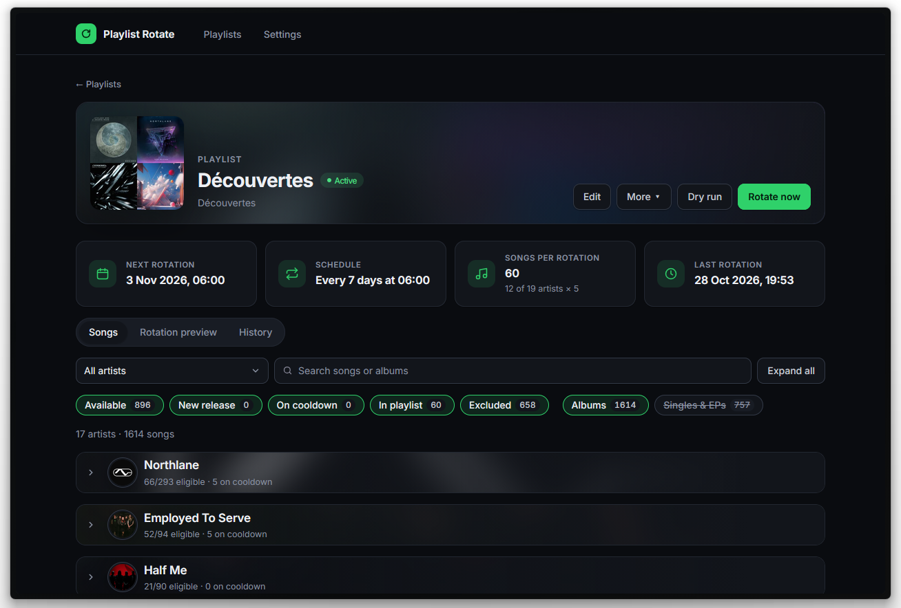

# Spotify Playlist Rotate

Keeps Spotify playlists fresh by rotating songs from a list of artists on a schedule.

It runs as two containers:

- **daemon:** runs 24/7, rotates the playlists and owns the database. It publishes no port.
- **web:** the manager UI. Start it when you want to change something; rotations don't need it.



## Personal note and disclaimer

> [!CAUTION] 
>'Spotify Playlist Rotate' was made for my own use case where I don't need extra security. This small project was built using Claude and reviewed by me. I don't plan releasing updates or maintaining it, unless for critical issues.  
>&nbsp;  
>When using it, make sure to never expose the web interface to Internet. Also don't leak your `.env` file, of course.   
>&nbsp;  
>David  

## Setup

1. Create an app in the [Spotify Developer Dashboard](https://developer.spotify.com/dashboard) and add
   `http://127.0.0.1:8000/api/auth/callback` as a redirect URI.
2. Copy `.env.example` to `.env` and fill in `SPOTIFY_CLIENT_ID`, `SPOTIFY_CLIENT_SECRET` and `TZ`.
3. Start both containers:

   ```bash
   docker compose up -d --build
   ```

4. Open <http://127.0.0.1:8000/settings>, click **Authorize with Spotify**, put the displayed
   `SPOTIFY_REFRESH_TOKEN` in `.env` and restart the daemon:

   ```bash
   docker compose up -d daemon
   ```

## How to use

Stop the web manager when you don't need it:

```bash
docker compose stop web
```

Start it again to make changes to the config:

```bash
docker compose start web
```

Both containers come back after a reboot unless you stopped them. `docker compose up -d` starts the web
manager too, so stop it afterwards if you want it off.

Errors are written to the daemon's logs:

```bash
docker compose logs daemon
```

## Running on a server

- Spotify only accepts `http` redirect URIs on `127.0.0.1`, so authorize on your own computer and copy the
  `.env` values to the server.
- Set `WEB_BIND` to the address the manager should listen on, such as your VPN interface IP. The manager has
  no login, so never expose it publicly.
- Your data is in `./data`. Stop the daemon before copying or opening the database.

## Configuration

| Variable | Default | Description |
|---|---|---|
| `SPOTIFY_CLIENT_ID` | | Spotify app client ID |
| `SPOTIFY_CLIENT_SECRET` | | Spotify app client secret |
| `SPOTIFY_REFRESH_TOKEN` | | Obtained once through the Settings page |
| `SPOTIFY_REDIRECT_URI` | `http://127.0.0.1:8000/api/auth/callback` | Must match the Spotify app settings |
| `TZ` | `UTC` | Timezone of the rotation times, e.g. `Europe/Zurich` |
| `SCHEDULER_POLL_SECONDS` | `60` | How often due playlists are checked |
| `SCHEDULER_MAX_RETRIES` | `1` | Hourly retries of a failed scheduled rotation. A Spotify rate limit postpones it until the limit ends instead |
| `WEB_BIND` | `127.0.0.1` | Address the web manager listens on |
| `WEB_PORT` | `8000` | Port the web manager listens on |

## Development

Requires Python 3.12+ and Node 22.

```bash
cd backend
pip install -r requirements.txt
uvicorn app.main:app --reload
```

```bash
cd frontend
npm install
npm run dev
```

The Vite dev server proxies `/api` to the backend on port 8000.
